<p align="center">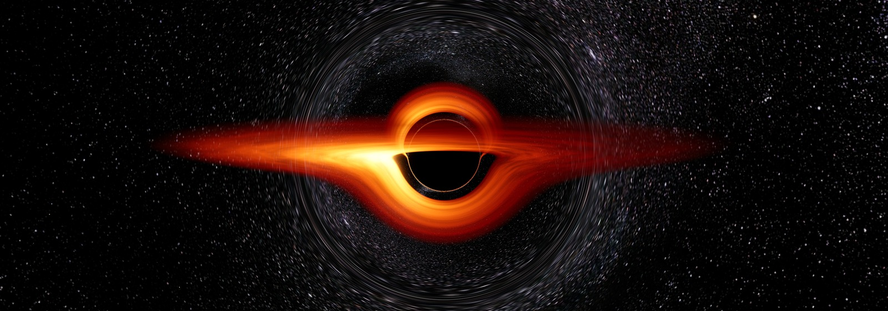</p>

# spayly

[](https://github.com/jackbelmore/spayly/actions/workflows/ci.yml)

A photoreal solar-system sandbox with real physics: the Sun, the eight planets, twenty-three
moons, five dwarf planets and the two largest asteroids, every one of them pulling on every other. You can
change the mass and size of anything (including the Sun) while it runs, and an asteroid mode lets you throw
rocks at any of it — planets, moons, or rocks you threw earlier — and watch physically-derived consequences,
from a Chelyabinsk airburst to shattering Earth.

The game is a native Godot 4.8 build (C#, GPU SPH collisions, black holes) in `godot/`; to set it up on a new computer
see [`docs/godot/setup.md`](docs/godot/setup.md). It began as a browser app (Vite + three.js), which is kept, no longer
developed, on the [`web-version`](https://github.com/jackbelmore/spayly/tree/web-version) branch.

<p align="center">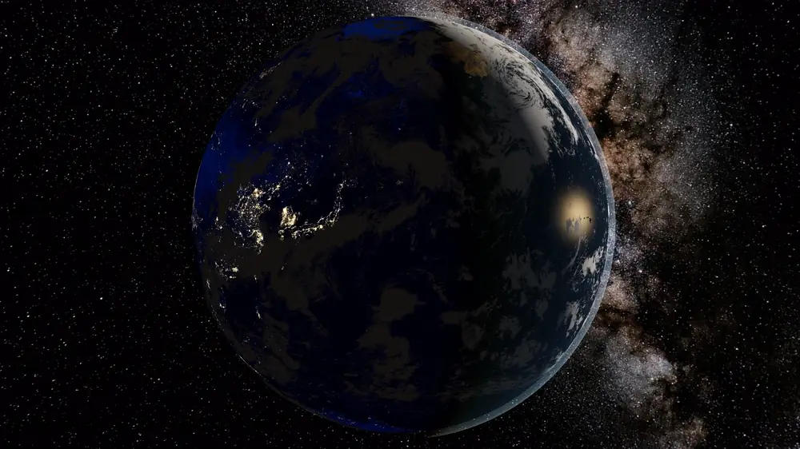</p>
<p align="center"><i>Earth in-game: 16K NASA maps, clouds, city lights and ocean glint. <a href="https://github.com/jackbelmore/spayly/releases/latest">Full 4K video on the Releases page.</a></i></p>

**[Watch the 73-second demo video](docs/media/demo.mp4)**: the solar system, Earth, Saturn and Jupiter up close, a Chicxulub-class
impact, a Theia giant impact in GPU SPH, a tidal disruption and a black hole's accretion disc. Recorded in-game.

## Features

Every clip is recorded in-game. Full-quality MP4s are on the [Releases page](https://github.com/jackbelmore/spayly/releases/latest).

<table>
<tr>
<td width="50%">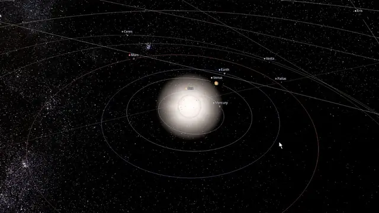<br><b>Click and fly.</b> Click any body or its label to select it, double-click to fly there, and wheel down to its surface.</td>
<td width="50%">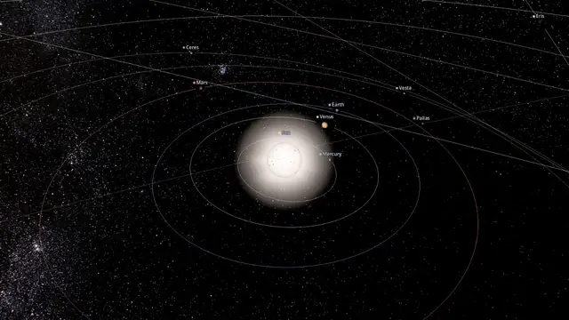<br><b>Drop a black hole in.</b> The forecast shows who gets torn apart. Crank the time warp and watch it swallow the Sun and capture the planets.</td>
</tr>
<tr>
<td>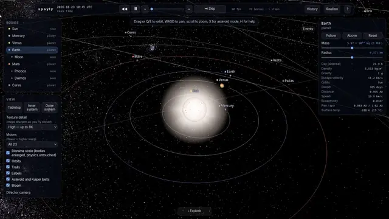<br><b>Bend time.</b> Warp up to millions of times real speed, pause, then rewind. Gravity runs backwards exactly.</td>
<td>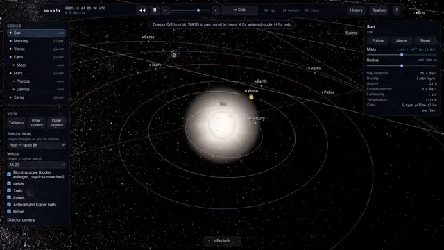<br><b>Change anything live.</b> Make the Sun ten times heavier and it burns blue-white while the orbits tighten. Make it a tenth and it fades to a red dwarf as the planets drift away.</td>
</tr>
<tr>
<td>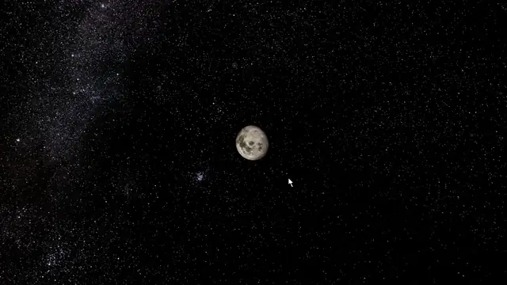<br><b>Throw asteroids.</b> Aim at any body and fire. The fireball, blast ring, ejecta and crater all follow from the impact energy.</td>
<td>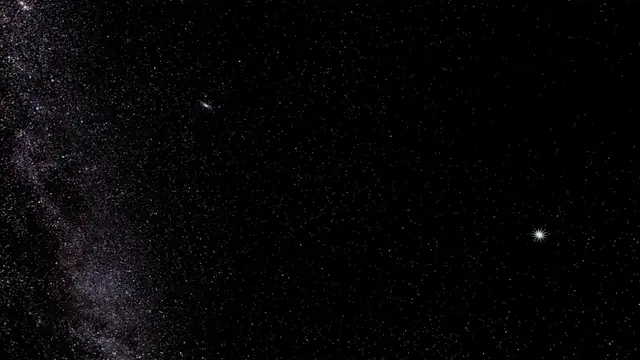<br><b>Tidal disruption.</b> A star falls into a million-solar-mass black hole: an Einstein ring, two lensed images, then the star is stretched apart and the disc lights up.</td>
</tr>
<tr>
<td>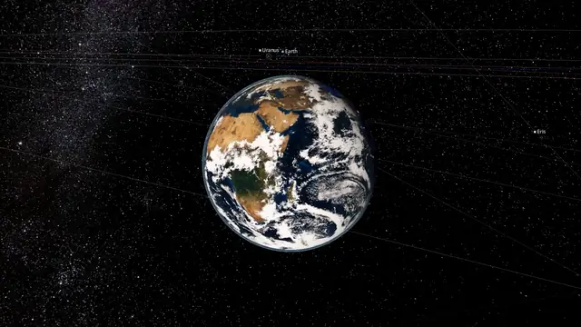<br><b>Tabletop view.</b> <code>T</code> pulls back to the whole system, and <code>F</code> flies above whatever you select.</td>
<td>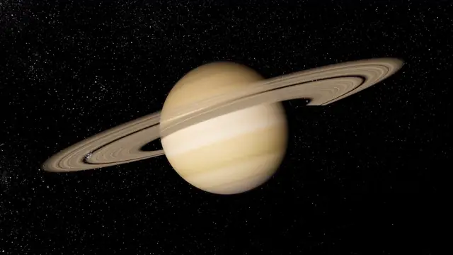<br><b>Up close.</b> Real spacecraft maps up to 16K, Saturn's rings with the planet's shadow across them, and lighting from the actual Sun.</td>
</tr>
<tr>
<td>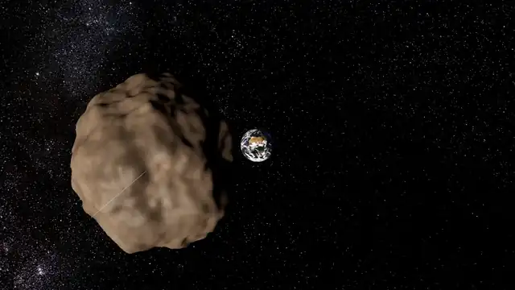<br><b>Shatter a planet.</b> Hit Earth hard enough and it doesn't crater, it shatters: 64 molten fragments and a debris cloud, all real bodies that keep orbiting.</td>
<td>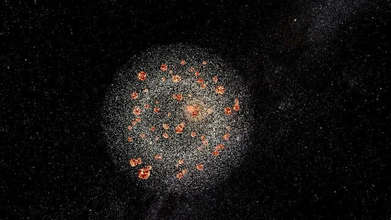<br><b>Undo anything.</b> <code>Ctrl+Z</code> takes back any action, even the end of the world.</td>
</tr>
<tr>
<td>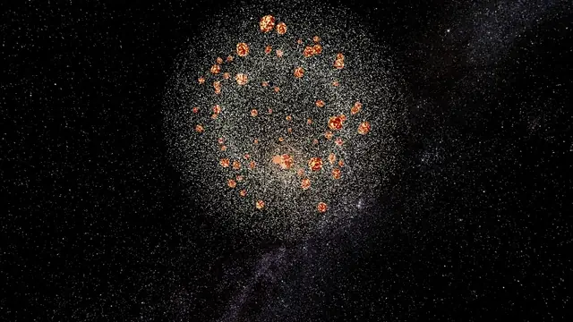<br><b>Erase brush.</b> <code>Z</code> sweeps debris and fragments out of the simulation, and the mouse wheel resizes the brush.</td>
<td>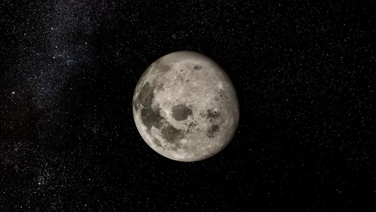<br><b>Down to the surface.</b> Fly from a full Moon down to its craters on NASA's 16K LRO map (Texture detail: Ultra).</td>
</tr>
</table>

## Play the Godot build

One command takes a computer with nothing set up to the game running. It needs git, git-lfs, Node 22+ and the .NET SDK 10+
(it tells you which are missing, with the install line for your OS, and installs none of them). It downloads Godot itself.

```bash
# macOS / Linux
curl -fsSL https://raw.githubusercontent.com/jackbelmore/spayly/main/bootstrap.sh | sh
```
```powershell
# Windows (PowerShell)
irm https://raw.githubusercontent.com/jackbelmore/spayly/main/bootstrap.ps1 | iex
```

Either clones into `./spayly` (set `SPAYLY_DIR` to choose another folder) and runs the launcher below.
`bootstrap` is fetched from `main` and run as it arrives, so read it before you pipe it into a shell.

Manual route:
1. Install git, git-lfs, Node 22+ and the .NET SDK 10+. `start` checks all four, lists whatever is missing, and installs none of them.
   - Windows: `winget install Git.Git GitHub.GitLFS OpenJS.NodeJS.LTS Microsoft.DotNet.SDK.10`, then open a **new** terminal.
   - macOS: `brew install git git-lfs node dotnet-sdk`
   - Fedora/RHEL: `sudo dnf install git git-lfs nodejs dotnet-sdk-10.0 unzip`
   - Debian/Ubuntu: `sudo apt install git git-lfs unzip dotnet-sdk-10.0`, plus Node 22+ from [nodejs.org](https://nodejs.org/en/download) if your distro's is older.
2. `git lfs install`, then `git clone https://github.com/jackbelmore/spayly && cd spayly`. Do the LFS step first, or the maps arrive as pointer files (`start` repairs that with `git lfs pull`).
3. Run `./start.sh`, or double-click `start.cmd` on Windows.

The first run pulls `main`, fetches the maps, runs `npm ci`, downloads Godot 4.8 (.NET) to `~/.local/opt/`, then builds and imports (a few
minutes). Later runs skip every step that is up to date, and launch in seconds. Flags: `--no-pull`, `--rebuild`, `--prepare-only`,
`--dry-run`; anything after `--` goes to Godot. Details and Windows notes (no Godot lock; maps hardlinked or copied where symlinks are
refused): [`docs/godot/setup.md`](docs/godot/setup.md).

## Development

```bash
dotnet test godot/Spayly.Sim.Tests   # physics test-suite (xUnit)
godot/tools/play.sh                  # build and launch without pulling
npm run assets      # downloads CC-licensed and public-domain body maps into public/textures
                    # (optional; procedural fallbacks exist for anything missing)
npm run textures    # lays out godot/Spayly.Game/textures/ from them (start.sh does this for you)
npm run ephemeris   # only when the JPL numbers in src/sim/satellites.ts should be refreshed
```

Node is tooling only: the texture bake and the ephemeris fetch. Press `H` in the game for the control sheet.

## Controls

| | |
| --- | --- |
| drag · wheel | orbit · zoom; once at a body's surface the wheel keeps zooming by narrowing the lens |
| `W` `A` `S` `D` | pan the view, holding shift to go faster; panning keeps following whatever you are following |
| `Q` `E` | swing the camera around what it is looking at |
| click · double-click | select a body · fly to it, either on the body or on its name in the view |
| space · `[` `]` · `R` | pause · slower, faster · rewind |
| `X` · `Z` | asteroid mode · erase mode (drag to delete asteroids and fragments, wheel resizes the brush) |
| `F` · `T` · `1`–`9`, `0` | fly above the selection · tabletop view · Sun, Mercury … Neptune, Pluto |

## What is real

- **Gravity.** Full mutual N-body integration with a symplectic kick-drift-kick leapfrog. Substeps adapt to the
  shortest dynamical timescale (close encounters get small steps); a per-frame cap throttles the time warp rather
  than skipping physics ("physics-limited" in the status bar). Time can run backwards.
- **Initial conditions.** Standish mean planetary elements (JPL), the Moon from Meeus' mean elements, the
  satellites from JPL's published mean elements referred to their local Laplace planes, and the dwarf planets
  and asteroids from the JPL Small-Body Database — all propagated to today's date, with each planet's system
  barycentre on the ephemeris position and the whole system's barycentre at rest. IAU rotation poles and
  prime-meridian rates give correct axial tilts and day/night; the tidally locked moons keep the face the sky
  sees turned towards their planet, Triton included, which goes round Neptune backwards.
- **Contacts.** Detection is swept, not sampled: within a substep a pair's relative motion is exactly a straight
  line, so the closest approach along it is solved for directly. A 20 m rock closing at 20 km/s covers 5 km in
  one substep and would otherwise pass clean through another 20 m rock.
- **Impacts.** Collins, Melosh & Marcus (2005): pancake-model atmospheric entry and airbursts, pi-group crater
  scaling, fireball, thermal radiation, seismic magnitude, ejecta blanket, air blast, tsunamis when Earth's oceans
  are hit. Merges conserve momentum exactly; impacts above a fraction of the target's gravitational binding energy
  shatter it into fragments that become real bodies (and re-accrete under their own gravity). What counts as
  shattering follows the regime: self-gravity above a few kilometres, and the Benz–Asphaug (1999) basalt
  strength law below it, so a boulder shrugs off a nudge that would tear a moon apart. Fragments can be
  shattered in turn, so a hard ceiling of 240 bodies keeps a cascade from breeding without end — past it a
  disrupting hit melts its target instead of scattering it, and mass and momentum still balance exactly.
- **Stars.** The Sun's luminosity and colour follow its mass (main-sequence relation) and radius; planets' equilibrium
  temperatures respond, and the shader shows Earth freezing or scorching.
- **Cheats that are visual only.** Diorama scale enlarges bodies so the whole system reads on screen; the minimum
  on-screen size keeps distant planets visible; sunlight falloff can be softened for legibility. None of it touches
  the simulation. Where a moon's published map has never-imaged regions — Voyager 2 only saw the southern halves
  of the Uranian moons — the loader grows the imaged terrain over them so the body is not rendered with a hole in
  it. That part is invented, and `public/textures/CREDITS.md` says so.

## Texture detail

Maps stream with the camera. A body far away is decoded at 1024 px; as it grows on screen the view
asks for the next power of two, up to the *Texture detail* ceiling in the View panel, and the large
map is released once the camera moves on. The ceiling caps the peak rather than forcing every body
to that size, and the options on offer are trimmed to what the GPU reports it can hold.

The sizing rule is one texel per pixel: you see 180 degrees of longitude at once, half the map,
across a disc two radii wide, so a map about four times the on-screen radius is 1:1.

How much a big map can ever help is set by the camera, not the file. The camera stops at a body's
surface, so on a 1080p screen at the default 50-degree lens a body never exceeds about 1150 px in
radius, and nothing past 8192 can show. That is why zooming past the surface stop narrows the lens
instead: at 20 degrees the same body reaches 3062 px and a 16384 map is finally 1:1.

Earth and the Moon come from the largest published sources — the 21600 px Blue Marble and NASA's
16384 px LROC colour mosaic — capped at 16384, which is the widest single texture almost every
desktop GPU accepts. Past that you need tiling, which is not implemented; at that point the limit is
the imagery rather than the pipeline.

## Time warp and the moon count

Substeps track the shortest dynamical timescale in the system, and Phobos goes round Mars in under eight hours.
With every moon in, the integrator resolves about 2 × 10⁶× real time before the status bar reads
"physics-limited"; on **Major only** it is about 3 × 10⁷×, and with **None** the slider's full 10⁸× is reachable.
The *Moons* control in the View panel is there for exactly that trade — watching Neptune go round once takes a
while otherwise. Nothing is faked either way: the warp is throttled, never skipped, and the status bar says
"limited" while it is happening.

A fresh cloud of fragments costs warp the same way for a second or two, because a dozen hundred-kilometre rocks
a few hundred kilometres apart genuinely do need short steps. Once they spread out the warp comes back. Erase
mode (`Z`) clears debris you are done with.

## Layout

```
godot/Spayly.Sim        physics in pure C#: N-body universe, Kepler math, ephemeris, catalog, impacts, collisions,
                        tidal disruption, black holes, undo history
godot/Spayly.Sim.Tests  xUnit physics tests (energy conservation, reversibility, impact model, collisions, ...)
godot/Spayly.Game       the Godot game: app loop, input and modes, views and shaders, GPU debris and SPH, HUD
godot/tools             start.mjs / play.sh launcher, godot.sh, run-capture.sh (screenshots + frame times), texture bake
src/sim, src/render     what is left of the web build: catalogue and texture-bake code the tools read; frozen
scripts                 fetch-assets.mjs (textures), fetch-ephemeris.mjs (regenerates src/sim/satellites.ts from JPL)
docs                    design.md (durable decisions), backlog.md, godot/ (port decisions, setup, verify queue)
```

## Visual iteration

`godot/tools/run-capture.sh godot/Spayly.Game --frames 300 -- --actions "select:earth;wait:60;shot:earth"` runs the
game under Xvfb on the real GPU, saves screenshots and frame times, and prints the log; `--resolution 3840x2160` tries
another screen size. The scripted verbs are in `godot/Spayly.Game/App/App.Capture.cs`.

## Credits

Textures: Solar System Scope (CC BY 4.0), NASA/JPL/USGS/SSI mosaics via Wikimedia Commons (public domain),
Björn Jónsson and Askaniy (CC BY / CC BY-SA), three.js examples (MIT). Per-body sources and licences are in
`public/textures/CREDITS.md`.

Ephemerides: JPL Solar System Dynamics — planetary satellite mean elements and physical parameters — and the
JPL Small-Body Database.

Impact model: Collins, Melosh & Marcus, *Earth Impact Effects Program*, Meteoritics & Planetary Science 40 (2005).
Disruption thresholds: Benz & Asphaug, *Catastrophic disruptions revisited*, Icarus 142 (1999).

## License

Copyright © 2026 Jack Belmore.

- **Code:** [PolyForm Noncommercial 1.0.0](LICENSE). Free to use, study, modify and share for any noncommercial purpose,
  as long as you keep the `Required Notice` line crediting the author.
- **Original assets** (docs, screenshots, demo video): [CC BY-NC 4.0](LICENSE-ASSETS.md). Free to reuse noncommercially with credit.
- **Third-party textures** keep their own licences (public domain, CC BY, CC BY-SA). See
  [`public/textures/CREDITS.md`](public/textures/CREDITS.md).

Commercial use, including selling the game or building a paid product on its code, needs a separate licence.
Contact [@jackbelmore](https://github.com/jackbelmore).
