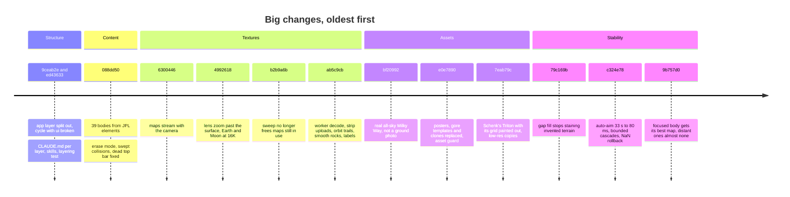
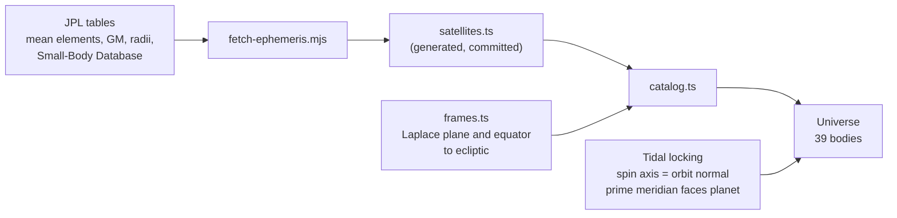
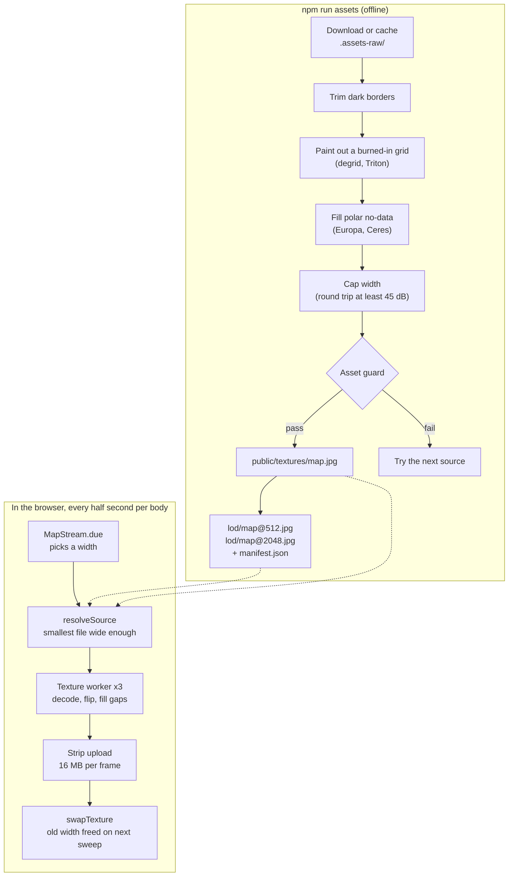
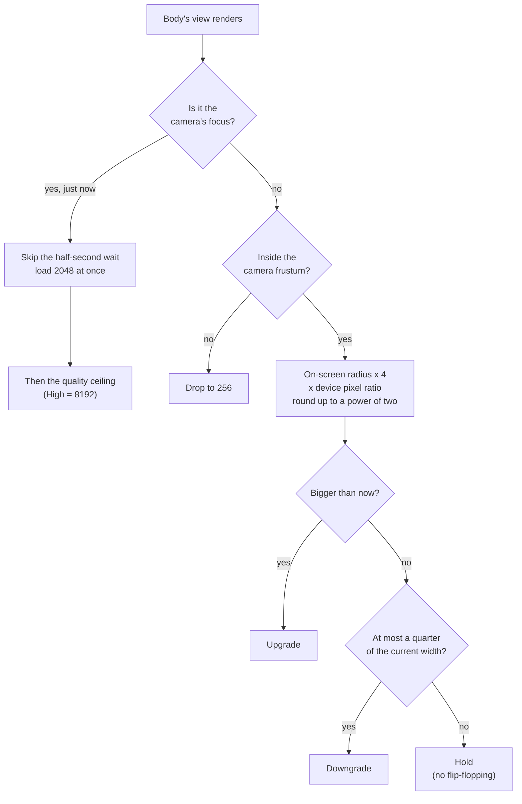
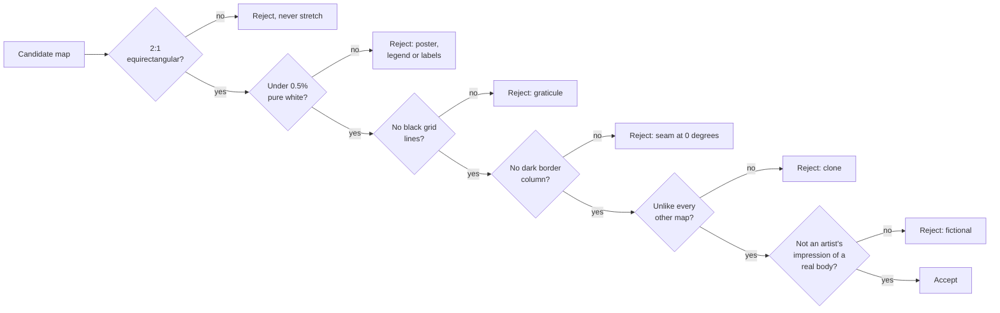
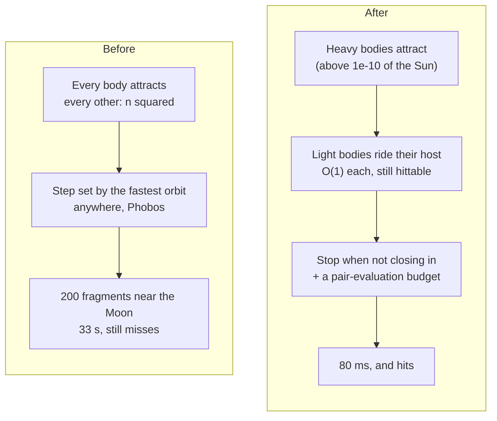
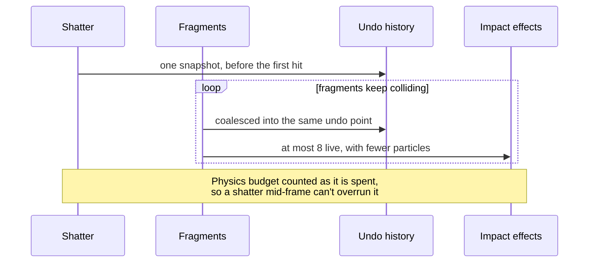
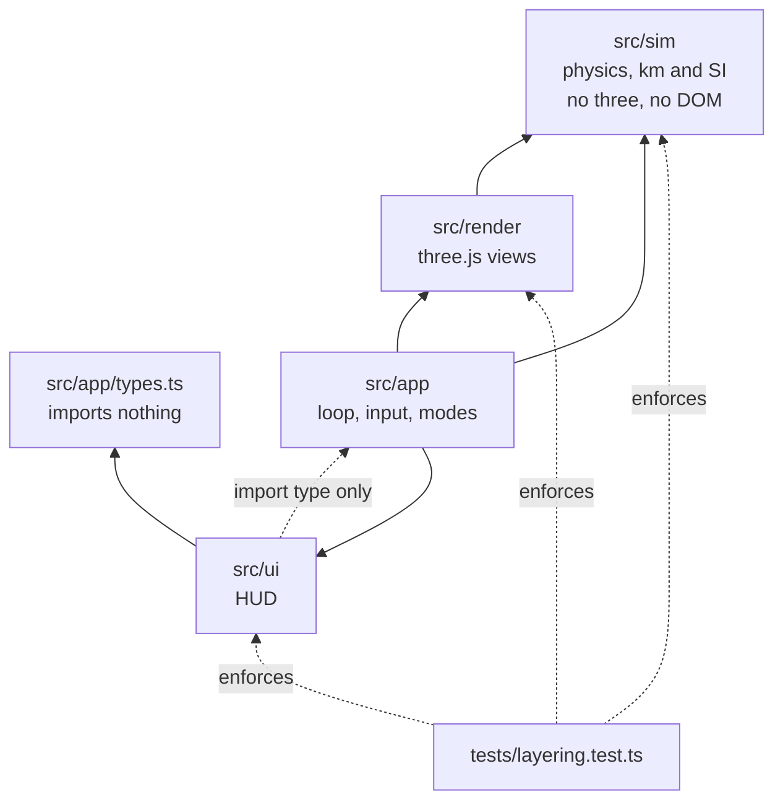
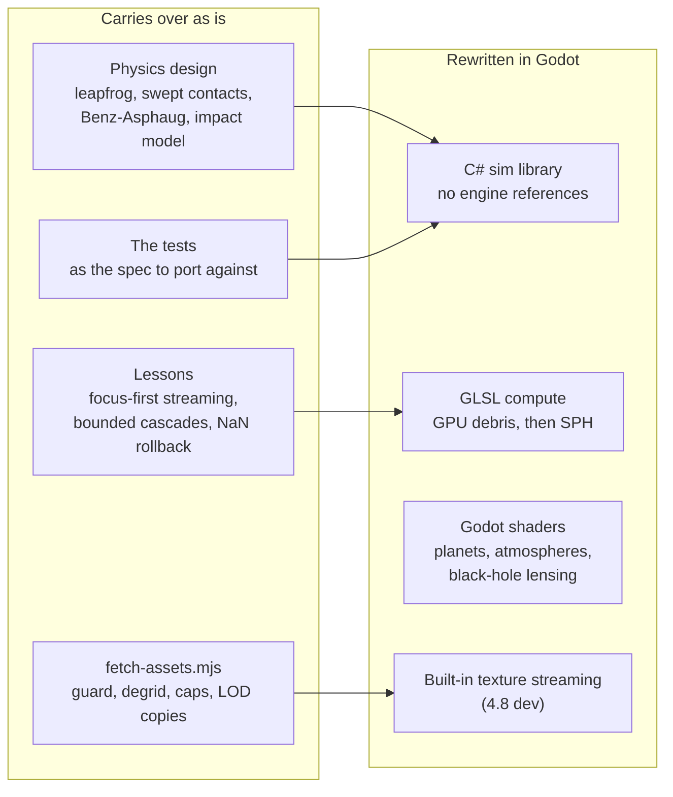

# September 2026: what changed

> **The big changes from `088dd50` to `9b757d0`.** Written as the web build is frozen and work moves
> to a Godot port.

## TL;DR

- 🌍 **10 → 39 bodies.** All 23 major moons plus Pluto, Ceres, Eris, Haumea, Makemake, Vesta and
  Pallas, with orbits from JPL and tidally locked moons facing their planets.
- 🖼️ **Maps that are real surfaces.** Europa was a poster, Uranus and Neptune were cut-out globe
  templates, Ceres had crater names printed on it, and three bodies were byte-identical copies of
  others. All of them are replaced, and an automated guard stops any of that coming back.
- 🔍 **Detail follows the camera.** Distant bodies get tiny maps, the body you double-click gets its
  best map at once, and a lens zoom takes Earth and the Moon to 16K.
- ⚡ **No more multi-second freezes.** Maps decode in workers, auto-aim no longer blocks the page for
  33 s in a debris cloud, and collision cascades have a bounded cost.
- 🧭 **Context for agents.** A `CLAUDE.md` per layer, skills for the recurring workflows, and a test
  that enforces the import rules.
- ➡️ **Next:** the Godot port. The web build's limits are its algorithms more than its language, but
  GPU compute is the way past 100k particles.

## Before and after

| | Before | After |
| --- | --- | --- |
| Bodies | 10 | **39** (240 with debris) |
| Auto-aim with 240 bodies | **33 s**, and missed | **80 ms** in the browser, and hits |
| Worst frame zooming Earth to 16K | 2,817 ms | **100 ms** |
| Worst frame zooming the Moon to 16K | 1,333 ms | **17 ms** |
| Long frames during startup | ~28 | **1** |
| Maps for bodies you aren't looking at | 115 MiB, all 1024 px | **~7 MiB**, 256 px |
| Double-clicked body's map | 1024 px, however long you waited | **2048 in 200 ms, 8192 by 1.6 s** |
| Undo snapshots per collision cascade | one per hit (a GC storm) | **one per cascade** |
| Physics budget during a mid-frame shatter | overran 1.85× | **kept** |
| Maps that were posters, templates, photos or clones | 9 | **0**, guarded |
| Tests | 20 | **46** |

## Timeline

---

## 1. The solar system got full

`088dd50` took the catalogue from 10 bodies to 39. Elements come from JPL (satellite mean elements,
GM and radius tables, and the Small-Body Database) through `scripts/fetch-ephemeris.mjs`, which
regenerates `src/sim/satellites.ts`.

The same commit made asteroids real physics citizens. Contacts are swept, so a 20 m rock at 20 km/s
can't pass through another. Disruption adds the Benz–Asphaug strength term, and the frame budget is
counted in pair evaluations, so more bodies throttle time warp rather than the frame rate.

## 2. Texture detail follows the camera

The largest body of work. A map's size is decided every half-second by what it covers on screen.
It's built off the main thread and uploaded in slices, so nothing stalls a frame.

### How a width is chosen

What made that fast:

- **Workers** (`ab5c9cb`). Chromium had been decoding 16K JPEGs synchronously inside the GPU upload,
  which cost seconds per zoom. Three workers now decode and hand back pixels already flipped, and the
  main thread uploads 16 MB slices each frame.
- **Low-res copies** (`7eab79c`, `9b757d0`). A body that is a dot on screen reads a 512 px copy
  instead of decoding a 16K original.
- **Lens zoom** (`4992618`). The camera stops at the surface, so zooming further narrows the field of
  view from 50° down to 6°. That's the only way a 16384 px map ever reaches one texel per pixel.
- **Sweep safety** (`b2b9a6b`). three.js has no finaliser, so every view keeps re-requesting what it
  shows, or the sweep frees a map that is still bound.

## 3. Maps that are actually surfaces

An audit found a lot of cartography where imagery should have been:

| Body | Was | Now |
| --- | --- | --- |
| Europa | USGS geologic-map **poster**: 57% white, legend, title block | USGS Voyager/Galileo mosaic, 16384 px |
| Uranus, Neptune | Printable **globe-gore templates**, nine cut-outs | Solar System Scope maps |
| Ceres | **18 crater names** and a full grid printed on | DLR Dawn mosaic |
| Makemake, Eris, Haumea | **Byte-identical copies** of Ceres, Pluto and Pallas | Their own maps |
| Saturn's ring | A **press photo** with "ISS" and "VIMS" printed on it | The procedural ring |
| Milky Way | A **ground photo**: horizon, trees, lit buildings | ESO all-sky map in galactic coordinates |
| Io | 1225 px, three hard seams | USGS colour mosaic, 8192 px |
| Triton | A smeared reprocessing | Paul Schenk's 600 m/px mosaic, black grid painted out |

The guard in `scripts/fetch-assets.mjs` runs on every download and on everything already on disk
(`npm run assets -- --check`):

Width caps are measured, not guessed. Each map is squeezed to a candidate width and back up, then
compared with the source; the cap is the smallest width that stays at least 45 dB (visually
lossless). That test overturned an earlier estimate that would have blurred ten moons.

## 4. The freezes and crashes

### Auto-aim: 33 s → 80 ms

The predictor integrated every body against every other on the click. Worse, it stepped at the pace
of the fastest orbit anywhere, Phobos, even when aiming at Earth.

### Collision cascades

Also in `c324e78`:
- A non-finite body state now rolls back to the last undo point and pauses. Before, NaN silently
  switched collision detection off for good.
- Orbit lines stopped allocating about 540 objects per body per frame.

### Renderer fixes (`ab5c9cb`, `79c169b`)

- **Orbit lines across the Saturn system** were moon trails drawn relative to the Sun. They're now
  drawn relative to the planet, and hidden at warps too fast to sample.
- **Asteroids** are a welded 19k-triangle mesh with smooth normals, not 500 faceted triangles.
- **Labels** sit above the body on screen, hide behind nearer bodies, and give way when they overlap.
- **Gap fill** no longer pulls from the dark ringing at a map's no-data edge, which had stained whole
  invented hemispheres dark and left a speckled rim on Charon and Umbriel.

## 5. Structure and agent context

Each layer has its own `CLAUDE.md` (it loads only when that directory is touched). `.claude/skills/`
covers the recurring workflows: `physics-change`, `visual-check`, `add-body`, `add-hud-control` and
`update-context`.
Every rule names what enforces it, or is marked *unenforced*.

---

## What carries over to Godot

The port is the next step. The measurement that drove it: in this JavaScript, all-pairs gravity takes
**282 ms per step at 10,000 bodies**, while a debris tier that feels the planets but not other debris
takes **5.9 ms**, 48× faster in the same language. Language buys about 2×; algorithms and GPU compute
buy orders of magnitude.

